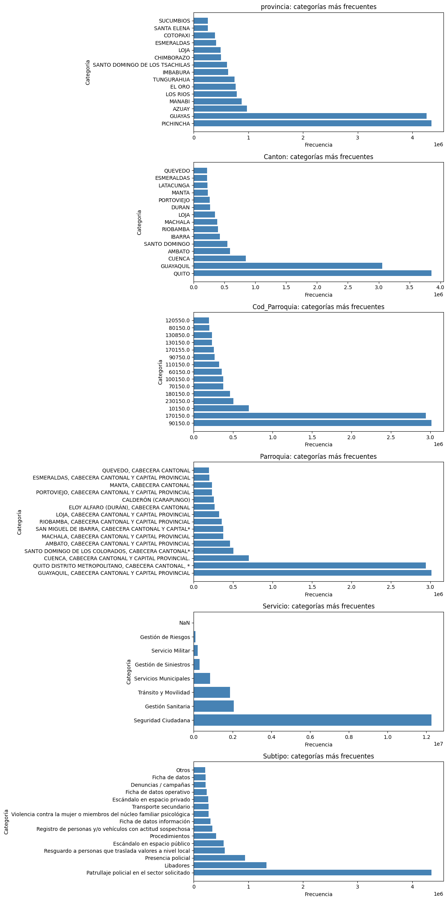
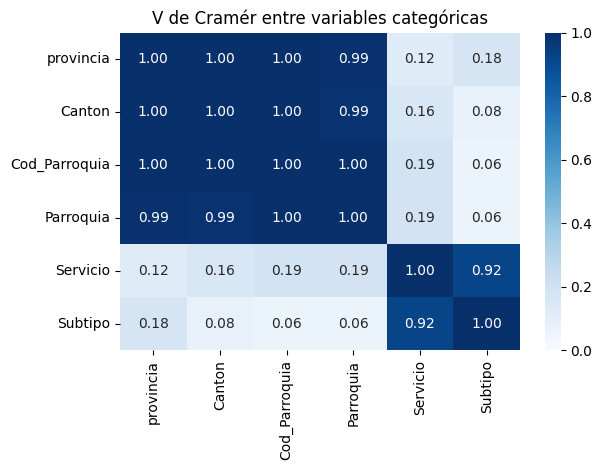
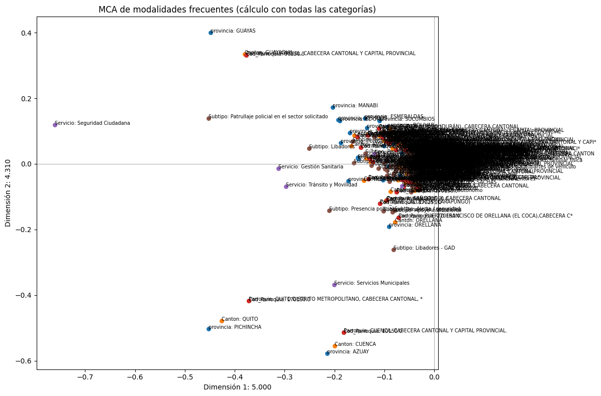
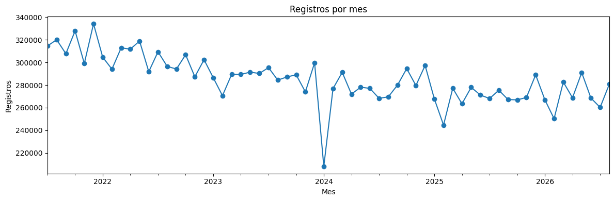
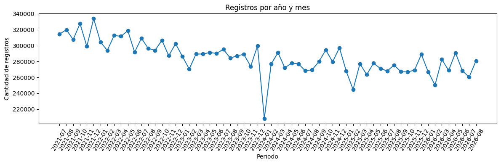

# Análisis exploratorio y preparación del dataset

## 1. Descripción detallada del dataset

El análisis corresponde a la base histórica de emergencias del ECU 911 seleccionada para el proyecto **“Generación de los puntos más peligrosos de Ecuador…”**. El propósito es describir los reportes por ubicación y tiempo, y preparar una base para estudiar zonas y periodos de mayor incidencia.
 En siguiente path docs\Semana1_ProyectoIntegrador_G3\Analisis_de_Datasets_Disponibles_Template_Grupo3.docx, identifica la fuente como datos abiertos del Gobierno de Ecuador se propone integrar las muestras mensuales del 2021 al 2026. 
 El notebook de preprocesamiento disponible documenta una extracción consolidada de **17.680.253 registros**, entre el **1 de julio de 2021 y el 31 de agosto de 2026**. Por ello, el periodo y tamaño de este análisis se refieren a esa extracción. 

La tabla fuente contiene fecha, ubicación administrativa y clasificación operativa del evento. El notebook carga siete columnas; `Index` corresponde a una columna auxiliar del archivo y no representa una característica del incidente.

| Campo | Significado y tipo | Uso previsto |
|---|---|---|
| `Fecha` | Fecha del reporte; temporal | Agregación mensual, estacionalidad y tendencias |
| `provincia` | Provincia; categórica nominal | Resumen y comparación geográfica |
| `Canton` | Cantón; categórica nominal | Perfil territorial |
| `Cod_Parroquia` | Código geográfico; identificador categórico | Enlace y agrupación, no magnitud numérica |
| `Parroquia` | Parroquia; categórica nominal | Unidad territorial fina del análisis |
| `Servicio` | Servicio ECU 911 asociado; categórica nominal | Agrupación del tipo de atención |
| `Subtipo` | Clasificación detallada del reporte; categórica nominal | Caracterización de incidentes y filtros de relevancia |

La base es de **registros de incidentes y atenciones**, no un censo directo de delitos, turistas o víctimas. No contiene coordenadas de latitud/longitud ni hora del evento; por tanto, sus resultados permiten comparar unidades administrativas y periodos, pero no ubicar puntos exactos ni estimar tasas de riesgo individual. Los recuentos no están ajustados por población, flujo turístico, exposición o cambios en la cobertura de reporte. La relación entre incidentes reportados y peligro para turistas requiere una definición de riesgo y validación de dominio antes de comunicar alertas.

## 2. Estadísticas descriptivas

Las variables son principalmente categóricas; media y desviación estándar no son medidas apropiadas para provincias, servicios o subtipos. Se resumen sus frecuencias, cardinalidades y concentración. Los porcentajes se calcularon sobre los 17.680.253 registros cargados.

| Variable | Valores distintos (incluye ausencias/categoría auxiliar según inspección) | Categoría más frecuente | Frecuencia / porcentaje |
|---|---:|---|---:|
| Provincia | 27 | Pichincha | 4.351.953 / 24,61 % |
| Cantón | 225 | Quito | 3.858.000 aprox. / 21,82 % |
| Código de parroquia | 1.043 | 90150 | 3.015.000 aprox. / 17,05 % |
| Parroquia | 981 | Guayaquil, cabecera cantonal y capital provincial | 3.015.000 aprox. / 17,05 % |
| Servicio | 8 | Seguridad Ciudadana | 12.268.977 / 69,39 % |
| Subtipo | 694 antes de normalizar | Patrullaje policial en el sector solicitado | 4.354.616 / 24,63 % |

Basado en el análisis de los datos se obtuvo lo siguiente:
Guayas es la segunda provincia con más registros (4.259.613; 24,09 %). Pichincha y Guayas concentran en conjunto **48,71 %**. Después de Seguridad Ciudadana, los servicios más frecuentes son Gestión Sanitaria (11,73 %) y Tránsito y Movilidad (10,63 %). Entre los subtipos, siguen Libadores (7,54 %) y Presencia policial (5,33 %). Estos recuentos reflejan volumen de reportes y prácticas de atención

En la dimensión temporal hay **62 meses calendario** desde julio de 2021 hasta agosto de 2026. Cada mes calendario del intervalo aparece en los registros; esto no permite asumir que una ausencia en otra extracción o fuente equivalga a cero. La fecha fue interpretable en todos los registros inspeccionados. El año 2026 está incompleto (enero–agosto), así que su total no se debe comparar directamente con años completos. El gráfico mensual evidencia variación temporal que se debe analizar distinguiendo estacionalidad, tendencia y cobertura.

La inspección detectó **11.745.103 filas exactamente duplicadas** según todas las columnas cargadas. Se conservaron durante el EDA. El conteo debe resolverse con la fuente.

## 3. Visualizaciones del EDA

Las seis figuras siguientes se extrajeron de las salidas del notebook `1_Preprocesamiento_V2.ipynb` (la figura de distribución contiene paneles para las variables categóricas). Se reproducen como análisis descriptivo de la extracción documentada.

### 3.1 Distribuciones categóricas

Se observan distribuciones asimétricas: pocas categorías concentran gran cantidad de registros y hay una cola extensa de ubicaciones y subtipos poco frecuentes. Seguridad Ciudadana domina la variable servicio; Pichincha y Guayas destacan en el agregado provincial. La escala y número de categorías hacen preferibles los rankings y porcentajes a comparar todas las etiquetas a la vez.

### 3.2 Asociaciones entre variables categóricas

Los códigos y nombres territoriales están fuertemente asociados, como cabe esperar por su jerarquía. Para variables nominales se empleó V de Cramér, no correlación de Pearson. Servicio–subtipo presenta V = 0,923; parte de esta asociación responde a que los subtipos pertenecen a servicios específicos. Provincia–servicio es mucho más moderada (V = 0,124). Con millones de filas

### 3.3 Perfiles de categorías (MCA)

La proyección de análisis de correspondencias múltiples resume proximidades entre modalidades, no entre coordenadas geográficas ni entre cada uno de los 17,7 millones de reportes. La proximidad sugiere perfiles que coaparecen en los datos; no implica causalidad. Las etiquetas escasas pueden ser difíciles de leer por la alta cardinalidad.

### 3.4 Datos faltantes
(eda_graficos/04_datos_faltantes.png)

Los faltantes son reducidos en proporción: provincia, cantón y parroquia presentan 2.144 (0,0121 %) cada uno; código de parroquia, 2.148 (0,0121 %); servicio, 2.221 (0,0126 %); subtipo, 89 (0,0005 %); fecha, ninguno. La coincidencia de faltantes territoriales sugiere que algunos registros carecen de ubicación

### 3.5 Categorías raras y valores extremos

Se consideró “rara” para revisión una categoría con menos del 0,1 % de las filas. Ese umbral identifica categorías escasas

### 3.6 Conteo por mes calendario

El gráfico sirve para detectar cambios y meses atípicos en el volumen. No debe interpretarse como una tasa de riesgo: los totales pueden cambiar por cobertura del dataset, población, demanda o prácticas operativas.

## 4. Patrones, asociaciones y atípicos

- **Concentración territorial:** Pichincha y Guayas agrupan casi la mitad de los registros; Quito y Guayaquil también destacan entre los cantones. Como no hay denominadores de población o turismo, estos lugares tienen mayor volumen observado, no necesariamente mayor riesgo por persona.
- **Concentración operativa:** Seguridad Ciudadana representa 69,39 % de los registros. El subtipo más frecuente, patrullaje policial solicitado, constituye 24,63 %. Este patrón puede estar influido por cómo se generan y clasifican las llamadas al ECU 911.
- **Dependencia geográfica:** provincia, cantón, código y nombre de parroquia codifican niveles territoriales relacionados.
- **Asociación servicio–subtipo:** es fuerte (V de Cramér 0,923), coherente con la estructura de clasificación. 
- **Desbalance de frecuencias:** las clases de `Servicio` y, sobre todo, `Subtipo` están desequilibradas. La clase mayoritaria de servicio supera dos tercios de los registros y cientos de subtipos son muy poco frecuentes.
- **Atípicos:** en datos categóricos se revisan valores raros e inválidos, no outliers numéricos. Para series agregadas, valores mensuales extremos deben contrastarse con la fuente. Los 11,7 millones de duplicados exactos son un hallazgo de calidad prioritario que requiere validación de clave.

## 5. Decisiones de preprocesamiento justificadas

1. **Preservar los archivos originales** y realizar transformaciones reproducibles
2. **Parsear `Fecha` con formato explícito/mixto y día primero**, y comprobar fechas no interpretadas y rango. En la ejecución documentada el rango es 2021-07-01–2026-08-31 y hubo cero fechas sin interpretar. Mantener fecha ausente.
3. **Tratar los códigos territoriales como categorías**, no variables numéricas continuas. Aplicar normalización de mayúsculas y espacios en los campos textuales para consolidar diferencias de formato. 
4. **Conservar `SIN DATO` como categoría explícita en campos categóricos** para no descartar filas ni confundir ausencia con una categoría válida
5. **No quitar duplicados a ciegas.**  Si se confirma que son repeticiones de carga, documentar la clave y conservar un conteo de filas antes y después.
6. **Atributos** (año, mes, día de semana y días desde inicio) para el EDA/modelado, manteniendo la fecha original como referencia 
7. **Agrupar por ubicación y mes** para obtener conteos de parroquia-mes
8. **Evitar publicar “puntos” exactos o niveles oficiales de peligro** a partir de estos campos. Para mapas puntuales se requiere incorporar una fuente geográfica validada 

## 6. Manejo de Datos faltantes y desbalance

### Datos faltantes

La tasa observada es inferior a 0,013 % en cada campo con ausencias. En la preparación documentada, las ausencias categóricas se hicieron explícitas como `SIN DATO`, . Esta opción conserva registros y permite medir si la falta de ubicación o clasificación se concentra en ciertos periodos o servicios. se analizo las métricas 

### Desbalance de clases

La distribución es desigual tanto entre servicios como entre subtipos y ubicaciones. Para EDA se conservan todas las categorías. Comparamos F1, recall por clase y matriz de confusión con la métrica global. Ponderación de clases o remuestreo se evaluarán únicamente dentro del conjunto de entrenamiento; el conjunto de validación/prueba debe conservar su prevalencia real. 

## 7. Limitaciones y próximos controles

El análisis se apoya en las salidas guardadas de los notebooksaL Final del modelo, confirmar consistencia entre los archivos mensuales originales y la extracción de 17,68 millones