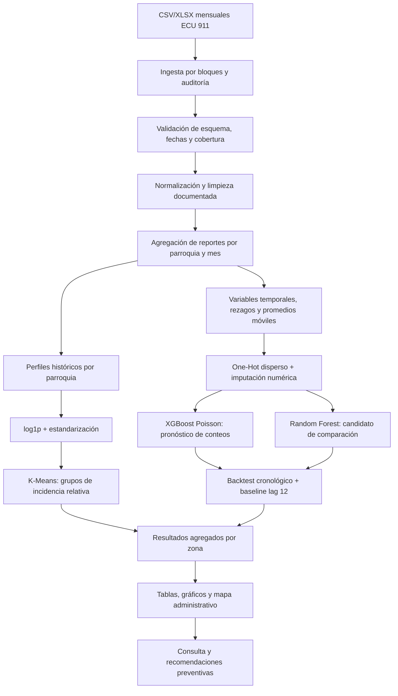

# Arquitectura del sistema de análisis y pronóstico de incidentes

## 1. Alcance y Tipo de modelo seleccionado y justificación

El proyecto tiene dos tareas relacionadas, pero distintas:

1. **Segmentar parroquias según sus perfiles históricos** con K-Means. Es un método no supervisado y descriptivo: identifica grupos de parroquias con patrones de volumen y variación similares. No es un clasificador de peligrosidad ni pronostica el futuro.
2. **Pronosticar conteos mensuales de reportes por parroquia** con XGBoost Regressor, configurado con objetivo Poisson. La salida es un conteo esperado de reportes

Como candidato de comparación se incluye Random Forest Regressor. En el notebook `2_Modelado_Implementacion_V2.ipynb`, Random Forest obtiene el menor MAE de validación entre los métodos comparados (18,87 incidentes por parroquia-mes frente a 29,98 del baseline estacional y 395,72 de PoissonRegressor). La implementación de XGBoost en los notebooks `3_entrenamiento_predicion_mes_1.0.ipynb` y `5_overfitting_analysis_1.0.ipynb` utiliza una partición temporal y evaluación final; en el diagnóstico de la versión más reciente el XGBoost seleccionado logró MAE 22,81 en prueba 2025, frente a 32,45 del baseline `lag_12`. Estos resultados provienen de experimentos y preparaciones diferentes, por lo que no deben compararse como si fueran una sola competencia controlada. El modelo definitivo se elige bajo el objetivo, los datos y el histórico 

**Decisión de arquitectura:** mantener K-Means para segmentación exploratoria y XGBoost para el flujo de pronóstico que tiene evaluación temporal final
Conservar Random Forest como alternativa/baseline de modelado hasta comparar ambos. Por consistencia con el notebook de diagnóstico se tienen conteos mensuales.

La métrica de K-Means en el análisis de parroquias fue silhouette 0,5365 para k=2 (entre k=2 y k=6); Davies–Bouldin fue 0,6421. Los nombres “baja” y “alta incidencia relativa” se asignan después de ordenar los grupos por promedio de incidentes. El resultado es propio de ese experimento y no garantiza rendimiento futuro.

## Arquitectura detallada (capas, parámetros, etc.)

| Capa | Responsabilidad | Entradas y salidas |
|---|---|---|
| 1. Fuentes | Se usa los los CSV/XLSX históricos mensuales del ECU 911, conservando los originales. | CSV/XLSX por año y mes; paquete consolidado `data/raw/data_proyecto/data_proyecto.csv`. |
| 2. Ingesta y control | Se lee por bloques, se verifica esquema, cobertura temporal, fechas, valores ausentes y registros inválidos. | Filas válidas y reporte de auditoría. El notebook de diagnóstico procesa bloques de hasta 250.000 filas. |
| 3. Preparación | Se normalizo textos y categorías, fechas; año/mes; se uso el reporte de incidentes por provincia, cantón, parroquia y mes. | Más campos temporales y geográficos. |
| 4. Ingeniería de variables |Promedios, tendencia y representación cíclica del mes; preparamos perfiles y estacionales para clustering. | se obtuvo una matriz dispersa para el pronóstico y matriz escalada de perfiles para K-Means. |
| 5. Modelado | Ajustamos K-Means para segmentación y XGBoost para pronóstico; usamos Random Forest como candidato comparativo. | Etiqueta de grupo por perfil y conteo mensual pronosticado por parroquia. |
| 6. Evaluación | Separamos cronológicamente entrenamiento, validación y prueba; comparamos con baseline estacional; se generan métricas de regresión y clustering. | Métricas, curvas y tablas de resultados. |
| 7. Presentación | Comunicar rankings, gráficos, mapa administrativo y recomendaciones preventivas a los usuarios del proyecto. | Vista de resultados para turistas y operadores. 
El diseño sigue las etapas CRISP-DM indicadas comprensión de datos, preparación, modelado, evaluación y despliegue. La arquitectura actual documentada se ejecuta principalmente en notebooks y conserva modelos serializados en `models/`.

## 3. Arquitectura detallada de los modelos

### 3.1 K-Means: segmentación de perfiles parroquiales

- **Unidad de análisis:** una parroquia identificada por provincia, cantón y nombre de parroquia.
- **Ventana de ajuste:** julio de 2021 a diciembre de 2023; se consideran ubicaciones con al menos 24 meses de historia registrada dentro de la ventana.
- **Perfil:** media mensual, desviación mensual, máximo, proporción de meses sin reportes y promedio para cada uno de los doce meses calendario.
- **Algoritmo/selección:** inicialización `++`, semilla 42, 100 iteraciones; se prueban k de 2 a 6. Se elige silhouette máximo, revisando también inercia y Davies–Bouldin. La silhouette se calcula con una muestra reproducible de hasta 10.000 perfiles.
- **Salida:** grupo por parroquia y resumen de incidencia relativa; PCA se usa solo para visualizar perfiles, no para ajustar los grupos.
- **Límite:** al no haber en los datos abiertos latitud/longitud ni denominadores de población o flujo turístico, el resultado es una agrupación administrativa por volumen reportado, no una coordenada de hotspot ni riesgo por persona.

### 3.2 XGBoost Regressor: pronóstico mensual
- **Objetivo:** `target_count`, cantidad de reportes por parroquia y mes. `objective='count:poisson'` produce una salida adecuada a conteos no negativos.
- **Unidad y geografía:** parroquia-mes con provincia, cantón y parroquia como variables categóricas.
- **Variables temporales:** seno y coseno del mes, tendencia mensual, rezagos 1, 3 y 12 meses y promedio
- **Preprocesamiento:** se ajusta solo en entrenamiento; se conserva matriz dispersa.
- **Parámetros base del diagnóstico:**  semilla 42, métrica de evaluación MAE. Se evalúan hasta 500 rondas y se escoge la iteración con menor MAE en validación
- **Validación temporal:** entrenamiento hasta diciembre de 2023, validación durante 2024 y prueba final durante enero–diciembre de 2025. Para la prueba final se vuelve a ajustar con información hasta diciembre de 2024, manteniendo la cantidad de árboles seleccionada con validación.
- **Métricas:** MAE, RMSE, R² y WAPE; comparación contra baseline `lag_12` (conteo del mismo mes del año previo). - **Salida:** conteo esperado de reportes por parroquia-mes, que puede agregarse por cantón, provincia y periodo para presentar resultados.

La implementación de `3_entrenamiento_predicion_mes_1.0.ipynb` contiene otro ajuste de XGBoost con `n_estimators=800`, `learning_rate=0.04`, `max_depth=6`, `min_child_weight=5`, `subsample=0.85`, `colsample_bytree=0.85`, `reg_lambda=5`, objetivo Poisson, `tree_method='hist'` y parada temprana de 40 rondas. Se documenta por separado porque corresponde a otra versión experimental.

### 3.3 Random Forest Regressor: candidato comparativo
El notebook de comparación usa un pipeline con la misma codificación geográfica dispersa y conteo objetivo. Configuración registrada: `n_estimators=80`, `max_depth=18`, `min_samples_leaf=10`, `max_features=0.8`, `n_jobs=-1`, `random_state=42`. El baseline complementario es el conteo observado doce meses antes (`lag_12`). La selección entre Random Forest y XGBoost se hace el mismo objetivo y split cronológico antes de declarar uno como modelo productivo.

## 4. Diagrama de flujo del sistema completo
Ver ficha de decisión técnica y arquitectura: docs\Semana2\Ficha de Decisión Técnica y Arquitectura Proyecto Integrador IA_G3 280926.docx

## 5. Pipeline de datos: desde la entrada hasta la salida

1. **Entrada:** archivos históricos mensuales del ECU 911, organizados por año en `data/raw/`; el README describe 61 archivos y cobertura desde 2021 hasta agosto de 2026. Se preservan sin sobrescritura.
2. **Lectura y auditoría:** se cargaron solo campos requeridos y se proceso por bloques para manejar el volumen. Revisamos tipos, categorías, duplicados, fechas, nulos y meses realmente cubiertos.
3. **Limpieza controlada:** normalizar espacios/mayúsculas, reconocer ausencias, validar los periodos y conservar códigos geográficos como categorías. Se elimino filas duplicadas.
4. **Agregación:** contar reportes por provincia, cantón, parroquia y mes. Los meses anteriores al primer reporte de una parroquia no se convierten en ceros.
5. **Features de pronóstico:** se uso únicamente meses anteriores al objetivo; añadir codificación cíclica del mes y tendencia. El objetivo es `target_count` (conteo parroquia-mes).
6. **Features de clustering:** para el periodo común de entrenamiento, resumir cada parroquia con media, desviación, máximo, meses sin reportes y patrón mensual; transformar conteos con `log1p` y escalar.
7. **Partición:** se separo temporalmente train hasta 2023, validación 2024 y prueba 2025. Ajustar imputadores, codificadores y escaladores exclusivamente en el conjunto de entrenamiento correspondiente.
8. **Entrenamiento y selección:** se comparó XGBoost/Random Forest con el baseline `lag_12` en validación. Seleccionar iteraciones/hiperparámetros sin consultar la prueba; para el K-Means con silhouette y revisión de perfiles.
9. **Evaluación:** medirse realizó regresión con MAE, RMSE, R² y WAPE; analizamos contra el baseline. Para K-Means se dibujo el silhouette, Davies–Bouldin e inercia. Conservamos resultados de prueba como evaluación final.
10. **Salida:** publicamos tablas y gráficos agregados, perfiles de incidencias y conteos pronosticados por zona/mes. Si se construye la vista web prevista, presentaremos datos, gráficos y resultados junto al mapa.

## 6. Tecnologías y librerías

Versiones declaradas en el README y archivos de dependencias del repositorio:

| Tecnología | Versión declarada | Uso |
|---|---|---|
| Python | 3.12.10 en README (instrucciones abreviadas como Python 3.12) | Entorno de notebooks y proyecto |
| pandas | 2.3.3 | Lectura por bloques, limpieza y agregación |
| NumPy | 2.3.5 | Cálculo de variables y arreglos |
| scikit-learn | 1.8.0 | Preprocesamiento, Random Forest, métricas, estandarización y PCA |
| XGBoost | `>=2.1,<4.0` | Regresión de conteos con boosting |
| Matplotlib | 3.10.9 | Gráficos y curvas de evaluación |
| Seaborn | 0.13.2 | Visualización estadística |local) | Servidor web previsto |
| Joblib | `>=1.4,<2.0` | Persistencia/carga de modelos `.joblib` |
| OpenPyXL | 3.1.5 | Lectura de XLSX |
| PyArrow | 21.0.0 | Soporte de formatos columnares |
| Tabulate | `>=0.9,<1.0` | Presentación tabular |
| Leaflet / OpenStreetMap | Sin versión fijada en README | Mapa web y mosaicos cartográficos |
| SciPy | Sin versión declarada | `scipy.cluster.vq.kmeans2` en el análisis de agrupamiento |

**Estado de reproducibilidad:** actualmente `requirements.txt` puede usar para isntaalr librerias.

